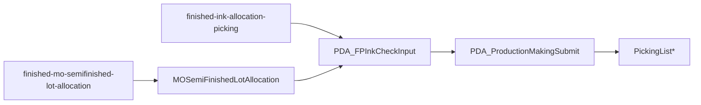

# Design: 成品灌墨指定批次与完工领料

## 状态
- **状态**：草稿 Draft
- **创建日期**：2026-07-17
- **数据库**：SQL Server `OrBitMOMTestBack`
- **改造对象**：`PDA_FPInkCheckInput`
- **上游依赖**：`finished-mo-semifinished-lot-allocation`

---

## 1. 总体方案

将 PDA 成品灌墨流程从“先领料、后灌墨”调整为“先预分配、后灌墨、完工前领料、完工后释放占用”。预分配台账由 `MOSemiFinishedLotAllocationDoMethod` 维护，本规格只改造 `PDA_FPInkCheckInput` 的消费与收尾逻辑。



设计原则：
- 扫描准入改读预分配，不再读领料单批次。
- 预分配数量只用于批次准入和工单扫描库存校验，不限制实际使用数量。
- 数量写入前必须校验批次库存可用量与剩余需求；实际使用确认后立即扣减对应库存。
- 扫描工单时必须校验已分配批次库存覆盖分配数量；不足时由仓库重新分配。
- 库存扣减、上料记录、批次跟踪和数据链必须在同一事务内完成。
- 领料单在完工前生成，不在灌墨扫描时生成。
- 释放占用保留历史，不做逻辑删除。
- 需要废弃的既有 SQL 只添加注释使其不执行，不直接删除。

---

## 2. 涉及对象

| 类型 | 路径 | 说明 |
|---|---|---|
| 改造过程 | `MES/procedure/PDA_FPInkCheckInput.sql` | PDA 成品灌墨 DoEvent |
| 预分配表 | `MES/table/MOSemiFinishedLotAllocation.sql` | 只读校验与完工释放 |
| 上料记录 | `LoadingItemLot`、`LoadingItemLotDetail`、`LoadingItemLotRecord` | 实际使用量 |
| 库存与批次追溯 | `WW_RMInventory`、`TxnBase_MLotTrack` | 扣减批次库存并记录库存变更轨迹 |
| 投料数据链 | `DataChainAssyIssue` | 灌墨投料关联 |
| 领料参考 | `MES/procedure/PDA_ProductionMakingSubmit.sql` L78–286 | `MakingComplete` 生成生产领料单 |
| 上料写入参考 | `MES/procedure/PDA_ProductionMaking_LotSNScan.sql` L781–895 | `UsedQtyScan` 的库存扣减、批次跟踪、上料记录和数据链写入 |

---

## 3. 事件分支设计

### 3.1 `InputScanDefocus` 工单扫描

**改造位置**：现有工单扫描成功、取得 `@MOId` 与工单物料明细之后（以实施时基线为准）。

**新增逻辑**：
1. 查询当前工单各物料的有效预分配记录，按 `MOItemId + ProductId + LotSN` 汇总分配 `Qty`。
2. 对每个已分配物料批次，汇总 `WW_RMInventory` 中相同物料、批次且 `LotStatus='1' AND IsStorage=1` 的 `Qty`。
3. 按工单物料比较“已分配批次库存总量”与“分配数量总量”。
4. 若任一物料库存不足，返回 `ServerMessage`（含工单号、物料号），提示“当前分配批次库存不足，请仓库重新分配”，并 `RETURN -1`。

**说明**：此校验用于发现分配后库存变动造成的无效分配；没有有效预分配记录的物料不在此处报错，仍由墨水批次扫描准入校验处理。

### 3.2 `InputScanDefocus` 墨水批次扫描

**改造位置**：原墨水扫描段（约 L828–898，以回退后基线为准）

**保留但禁用的既有逻辑**：
- `PickingListItemLot` / `OrgLotSN` 的已领料校验
- 基于领料数量的 `@BeginQty` 自动用量计算

以上代码块保留在原位置并改为 SQL 注释；每段前注明“改由预分配批次准入/实时库存数量校验替代”，不得直接删除。

**新增逻辑**：
1. 校验 `WW_RMInventory` 批次在库。
2. 校验工单 BOM、半成品分类、重复扫描。
3. 查询 `MOSemiFinishedLotAllocation` 有效占用分配。
4. 计算：
   - `@MRemainQty = @MQtyRequired - @MActualQty`
   - `@LotAvailableQty = SUM(WW_RMInventory.Qty)`
   - 不以 `MOSemiFinishedLotAllocation.Qty` 限制实际使用数量。
   - 不再减当前会话的 `LoadingItemLotRecord.Qty`，因为该数量写入时已同步从库存扣除。
5. 分支：
   - `@LotAvailableQty > @MRemainQty`：返回建议数量，`Command='MLotSNScan'`，不写库
   - 否则：`@UsedQty = @LotAvailableQty`，沿用现有自动写入逻辑

**返回示例（超量确认）**：

```sql
SELECT CAST(@MRemainQty AS NVARCHAR(50)) AS InputNumber,
       @MRemainQty AS MQtyRequired,
       @MActualQty AS MActualQty,
       @InputScan AS InputScan,
       'MLotSNScan' AS Command,
       ...
SET @I_ExceptionFieldName = 'InputNumber';
RETURN 0;
```

### 3.3 `InputNumberDefocus` + `Command='MLotSNScan'`

**改造位置**：原数量确认段（约 L1318–1588）

**新增校验**：
1. 重新计算库存口径的 `@LotAvailableQty` 与 `@MRemainQty`。
2. 校验 `@InputNumber` 为合法数字且 `> 0`。
3. 校验 `@UsedQty <= @LotAvailableQty` 且 `@UsedQty <= @MRemainQty`。
4. 通过后按 `PDA_ProductionMaking_LotSNScan` 的 `UsedQtyScan` 分支开启上料事务，写入下述数据。
   - 更新 `LoadingItemLotDetail.ActualQty`。
   - 按当前批次 `WWId` 扣减 `WW_RMInventory.Qty`，扣减前再次校验库存余额。
   - 调用 `TxnBase_MLotTrack`，记录扣减前库存、本次上料数量、扣减后库存及工单号。
   - 生成并插入 `LoadingItemLotRecord`。
   - 调用 `TxnBase_DataChainMainLine`，生成并插入 `DataChainAssyIssue`。
5. 自动写入路径复用同一写入单元，确保自动写入和数量确认的库存、追溯与数据链口径完全一致。

### 3.4 自动完工

**改造位置**：原 `@MQtyRequired <= @MActualQty + @UsedQty` 分支（约 L1092–1283）

**执行顺序**：

```
1. PDA_ProductionMakingSubmit(@I_Sender='MakingComplete')
2. TxnBase_LotMove（批次启动 / 灌墨规程）
3. MOProductionOrder（存在 MoCraftPath WorkstageNO='10' 时）
4. UPDATE MOSemiFinishedLotAllocation SET IsOccupyAllocatedQty=0
```

### 3.5 `CMDLOTMOVE` 手工下线

**改造位置**：原 `@Command='CMDLOTMOVE'` 分支（约 L1596–1785）

与自动完工保持一致：先领料，再过站报工，再释放占用。

---

## 4. 数量与库存校验口径

```sql
-- 工单物料剩余需求
@MRemainQty = ISNULL(@MQtyRequired, 0) - ISNULL(@MActualQty, 0)

-- 扫描工单时：当前物料批次预分配总量
@LotAllocatedQty = SUM(Qty)
FROM MOSemiFinishedLotAllocation
WHERE MOId = @MOId
  AND DeleteFlag = '0'
  AND IsOccupyAllocatedQty = 1

-- 扫描工单时：同一物料与已分配批次的实际在库总量
@AllocatedLotStockQty = SUM(WW_RMInventory.Qty)
FROM #AllocatedLots AllocatedLot
INNER JOIN WW_RMInventory ON ...
WHERE WW_RMInventory.LotStatus = '1'
  AND WW_RMInventory.IsStorage = 1

-- 工单扫描校验
@AllocatedLotStockQty >= @LotAllocatedQty

-- 墨水批次扫描时：当前批次实际在库数量
@LotStockQty = SUM(WW_RMInventory.Qty)
FROM WW_RMInventory
WHERE ProductId = @MProductId
  AND LotSN = @InputScan
  AND LotStatus = '1'
  AND IsStorage = 1

-- 当前批次可用量
@LotAvailableQty = @LotStockQty
```

`@LotAllocatedQty` 不参与墨水批次扫描和数量确认的使用数量上限计算；只要存在有效占用分配记录，该批次即可使用。`LoadingItemLotRecord` 写入时会同步扣减 `WW_RMInventory.Qty`，因此可用量不得再减当前会话已用数量，避免重复扣减。

### 4.1 上料写入顺序

自动写入与 `InputNumberDefocus` 确认写入均执行以下事务单元，逻辑参照 `PDA_ProductionMaking_LotSNScan` 的 `@I_Sender='UsedQtyScan'` 分支：

```
1. 重新校验 WW_RMInventory.Qty >= @UsedQty
2. UPDATE LoadingItemLotDetail，累计 ActualQty
3. UPDATE WW_RMInventory SET Qty = Qty - @UsedQty（按当前 WWId）
4. EXEC TxnBase_MLotTrack，写入批次追踪
5. INSERT LoadingItemLotRecord，写入本次上料记录
6. EXEC TxnBase_DataChainMainLine 并 INSERT DataChainAssyIssue
7. COMMIT；任一步失败则 ROLLBACK
```

---

## 5. 完工领料设计

复用 `PDA_ProductionMakingSubmit` 的 `MakingComplete` 分支，不在 `PDA_FPInkCheckInput` 内重复实现领料单 SQL。

**调用方式**：

```sql
EXEC @RESULT = dbo.PDA_ProductionMakingSubmit
    @I_Sender = 'MakingComplete',
    @LoadingItemLotId = @LoadingItemLotId,
    ...
IF @RESULT <> 0
    RETURN @RESULT;
```

**数据来源**：当前 `LoadingItemLot` 内 `IsPicking=0` 的 `LoadingItemLotRecord`，与现有制作完成领料口径一致。

---

## 6. 占用释放设计

完工成功后，按当前会话实际使用批次释放占用：

```sql
UPDATE Allocation
SET IsOccupyAllocatedQty = 0,
    ModifyDate = GETDATE()
FROM dbo.MOSemiFinishedLotAllocation Allocation
INNER JOIN dbo.LoadingItemLotRecord LotRecord ON LotRecord.LotSN = Allocation.LotSN
INNER JOIN dbo.LoadingItemLotDetail Detail ON Detail.LoadingItemLotDetailId = LotRecord.LoadingItemLotDetailId
WHERE Detail.LoadingItemLotId = @LoadingItemLotId
  AND Allocation.MOId = @MOId
  AND Allocation.MOItemId = Detail.MOItemId
  AND Allocation.DeleteFlag = '0'
  AND Allocation.IsOccupyAllocatedQty = 1
```

---

## 7. 事务与失败策略

| 步骤 | 事务范围 | 失败处理 |
|---|---|---|
| 扫描/数量确认写入 | `BEGIN TRANSACTION LOADING`：上料明细、库存扣减、批次跟踪、`LoadingItemLotRecord` 与 `DataChainAssyIssue` | 任一步失败即回滚全部写入并返回 `ServerMessage` |
| 领料单生成 | `PDA_ProductionMakingSubmit` 内部 `BEGIN TRANSACTION PickingLot` | 回滚领料，`RETURN -1` |
| 过站报工 | 既有 `TxnBase_LotMove` / `MOProductionOrder` | 返回错误，不释放占用 |
| 占用释放 | 与完工成功同路径执行 | 仅在过站报工成功后更新 |

**约束**：领料失败时不允许继续过站；过站失败时不释放预分配占用；库存扣减不得脱离上料记录、批次跟踪或数据链独立提交。

---

## 8. 错误提示

| 场景 | 提示示例 |
|---|---|
| 工单已分配批次库存不足 | `ServerMessage:[工单号][{MOName}][物料号][{ProductName}]当前分配批次库存不足，请仓库重新分配！` |
| 未指定批次 | `ServerMessage:墨水批次【{LotSN}】未指定给工单【{MOName}】，请更换批次扫描！` |
| 可用量不足 | `ServerMessage:墨水批次【{LotSN}】已无可用库存数量，请更换批次扫描！` |
| 超量确认 | `ServerMessage:墨水批次【{LotSN}】可用数量大于剩余需求，请确认使用数量【{Qty}】` |
| 数量非法 | `ServerMessage:输入数量【{InputNumber}】超过墨水批次【{LotSN}】可用库存数量或工单剩余需求，请重新输入` |

---

## 9. 部署注意事项

- 须先确保 `MOSemiFinishedLotAllocation` 表与预分配 DoMethod 已部署。
- 本改造脚本：`MES/procedure/PDA_FPInkCheckInput.sql`。
- 除 SELECT 外不直接在生产执行，需 DBA 审批。
- 部署后使用测试工单验证扫描、数量确认、自动/手动完工、领料单与占用释放。
