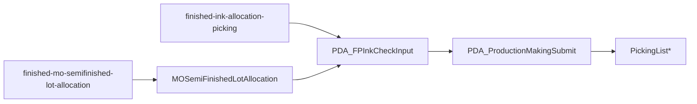

# Design: 成品灌墨指定批次与完工领料

## 状态
- **状态**：草稿 Draft
- **创建日期**：2026-07-17
- **数据库**：SQL Server `OrBitMOMTestBack`
- **改造对象**：`PDA_FPInkCheckInput`
- **上游依赖**：`finished-mo-semifinished-lot-allocation`

---

## 1. 总体方案

将 PDA 成品灌墨流程从“先领料、后灌墨”调整为“先预分配、后灌墨、完工前领料、完工后释放占用”。预分配台账由 `MOSemiFinishedLotAllocationDoMethod` 维护，本规格只改造 `PDA_FPInkCheckInput` 的消费与收尾逻辑。



设计原则：
- 扫描准入改读预分配，不再读领料单批次。
- 数量写入前必须校验预分配余额与剩余需求。
- 领料单在完工前生成，不在灌墨扫描时生成。
- 释放占用保留历史，不做逻辑删除。

---

## 2. 涉及对象

| 类型 | 路径 | 说明 |
|---|---|---|
| 改造过程 | `MES/procedure/PDA_FPInkCheckInput.sql` | PDA 成品灌墨 DoEvent |
| 预分配表 | `MES/table/MOSemiFinishedLotAllocation.sql` | 只读校验与完工释放 |
| 上料记录 | `LoadingItemLot`、`LoadingItemLotDetail`、`LoadingItemLotRecord` | 实际使用量 |
| 投料数据链 | `DataChainAssyIssue` | 灌墨投料关联 |
| 领料参考 | `MES/procedure/PDA_ProductionMakingSubmit.sql` L78–286 | `MakingComplete` 生成生产领料单 |

---

## 3. 事件分支设计

### 3.1 `InputScanDefocus` 墨水批次扫描

**改造位置**：原墨水扫描段（约 L828–898，以回退后基线为准）

**移除逻辑**：
- `PickingListItemLot` / `OrgLotSN` 的已领料校验
- 基于领料数量的 `@BeginQty` 自动用量计算

**新增逻辑**：
1. 校验 `WW_RMInventory` 批次在库。
2. 校验工单 BOM、半成品分类、重复扫描。
3. 查询 `MOSemiFinishedLotAllocation` 有效占用分配。
4. 计算：
   - `@MRemainQty = @MQtyRequired - @MActualQty`
   - `@LotAvailableQty = SUM(分配Qty) - SUM(当前会话已用Qty)`
5. 分支：
   - `@LotAvailableQty > @MRemainQty`：返回建议数量，`Command='MLotSNScan'`，不写库
   - 否则：`@UsedQty = @LotAvailableQty`，沿用现有自动写入逻辑

**返回示例（超量确认）**：

```sql
SELECT CAST(@MRemainQty AS NVARCHAR(50)) AS InputNumber,
       @MRemainQty AS MQtyRequired,
       @MActualQty AS MActualQty,
       @InputScan AS InputScan,
       'MLotSNScan' AS Command,
       ...
SET @I_ExceptionFieldName = 'InputNumber';
RETURN 0;
```

### 3.2 `InputNumberDefocus` + `Command='MLotSNScan'`

**改造位置**：原数量确认段（约 L1318–1588）

**新增校验**：
1. 重新计算 `@LotAvailableQty` 与 `@MRemainQty`。
2. 校验 `@InputNumber` 为合法数字且 `> 0`。
3. 校验 `@UsedQty <= @LotAvailableQty` 且 `@UsedQty <= @MRemainQty`。
4. 通过后写入 `LoadingItemLotDetail`、`LoadingItemLotRecord`、`DataChainAssyIssue`。

### 3.3 自动完工

**改造位置**：原 `@MQtyRequired <= @MActualQty + @UsedQty` 分支（约 L1092–1283）

**执行顺序**：

```
1. PDA_ProductionMakingSubmit(@I_Sender='MakingComplete')
2. TxnBase_LotMove（批次启动 / 灌墨规程）
3. MOProductionOrder（存在 MoCraftPath WorkstageNO='10' 时）
4. UPDATE MOSemiFinishedLotAllocation SET IsOccupyAllocatedQty=0
```

### 3.4 `CMDLOTMOVE` 手工下线

**改造位置**：原 `@Command='CMDLOTMOVE'` 分支（约 L1596–1785）

与自动完工保持一致：先领料，再过站报工，再释放占用。

---

## 4. 数量口径

```sql
-- 工单物料剩余需求
@MRemainQty = ISNULL(@MQtyRequired, 0) - ISNULL(@MActualQty, 0)

-- 当前批次预分配占用总量
@LotAllocatedQty = SUM(Qty)
FROM MOSemiFinishedLotAllocation
WHERE MOId = @MOId
  AND MOItemId = @IssueMOItemId
  AND ProductId = @MProductId
  AND LotSN = @InputScan
  AND DeleteFlag = '0'
  AND IsOccupyAllocatedQty = 1

-- 当前上料会话已使用量
@LotUsedQty = SUM(LoadingItemLotRecord.Qty)
FROM LoadingItemLotRecord
INNER JOIN LoadingItemLotDetail ...
WHERE LoadingItemLotId = @LoadingItemLotId
  AND MOItemId = @IssueMOItemId
  AND LotSN = @InputScan

-- 当前批次可用量
@LotAvailableQty = @LotAllocatedQty - @LotUsedQty
```

---

## 5. 完工领料设计

复用 `PDA_ProductionMakingSubmit` 的 `MakingComplete` 分支，不在 `PDA_FPInkCheckInput` 内重复实现领料单 SQL。

**调用方式**：

```sql
EXEC @RESULT = dbo.PDA_ProductionMakingSubmit
    @I_Sender = 'MakingComplete',
    @LoadingItemLotId = @LoadingItemLotId,
    ...
IF @RESULT <> 0
    RETURN @RESULT;
```

**数据来源**：当前 `LoadingItemLot` 内 `IsPicking=0` 的 `LoadingItemLotRecord`，与现有制作完成领料口径一致。

---

## 6. 占用释放设计

完工成功后，按当前会话实际使用批次释放占用：

```sql
UPDATE Allocation
SET IsOccupyAllocatedQty = 0,
    ModifyDate = GETDATE()
FROM dbo.MOSemiFinishedLotAllocation Allocation
INNER JOIN dbo.LoadingItemLotRecord LotRecord ON LotRecord.LotSN = Allocation.LotSN
INNER JOIN dbo.LoadingItemLotDetail Detail ON Detail.LoadingItemLotDetailId = LotRecord.LoadingItemLotDetailId
WHERE Detail.LoadingItemLotId = @LoadingItemLotId
  AND Allocation.MOId = @MOId
  AND Allocation.MOItemId = Detail.MOItemId
  AND Allocation.DeleteFlag = '0'
  AND Allocation.IsOccupyAllocatedQty = 1
```

---

## 7. 事务与失败策略

| 步骤 | 事务范围 | 失败处理 |
|---|---|---|
| 扫描/数量确认写入 | 沿用现有单步写入 | 返回 `ServerMessage`，不写库 |
| 领料单生成 | `PDA_ProductionMakingSubmit` 内部 `BEGIN TRANSACTION PickingLot` | 回滚领料，`RETURN -1` |
| 过站报工 | 既有 `TxnBase_LotMove` / `MOProductionOrder` | 返回错误，不释放占用 |
| 占用释放 | 与完工成功同路径执行 | 仅在过站报工成功后更新 |

**约束**：领料失败时不允许继续过站；过站失败时不释放预分配占用。

---

## 8. 错误提示

| 场景 | 提示示例 |
|---|---|
| 未指定批次 | `ServerMessage:墨水批次【{LotSN}】未指定给工单【{MOName}】，请更换批次扫描！` |
| 可用量不足 | `ServerMessage:墨水批次【{LotSN}】已无可用指定数量，请更换批次扫描！` |
| 超量确认 | `ServerMessage:墨水批次【{LotSN}】可用数量大于剩余需求，请确认使用数量【{Qty}】` |
| 数量非法 | `ServerMessage:输入数量【{InputNumber}】超过墨水批次【{LotSN}】可用指定数量或工单剩余需求，请重新输入` |

---

## 9. 部署注意事项

- 须先确保 `MOSemiFinishedLotAllocation` 表与预分配 DoMethod 已部署。
- 本改造脚本：`MES/procedure/PDA_FPInkCheckInput.sql`。
- 除 SELECT 外不直接在生产执行，需 DBA 审批。
- 部署后使用测试工单验证扫描、数量确认、自动/手动完工、领料单与占用释放。
