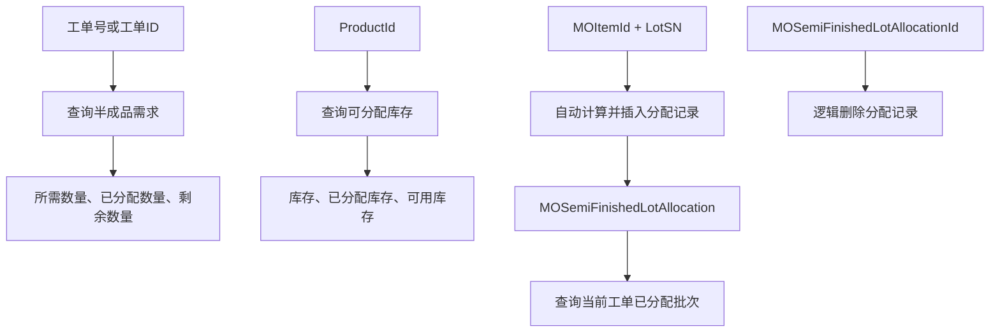

# Design: 成品工单半成品批次分配

## 状态
- **状态**：草稿 Draft
- **创建日期**：2026-07-06
- **数据库**：SQL Server `OrBitMOMTestBack`
- **参考对象**：`MO`、`MOItem`、`Product`、`ProductRoot`、`WW_RMInventory`

---

## 1. 总体方案

新增一张独立分配记录表和一个 DoMethod 风格存储过程。存储过程通过 `@I_Sender` 区分查询、分配和删除动作。



设计原则：
- 分配记录只做预分配台账，不直接扣库存。
- 所有可用库存均从库存表数量扣减有效分配记录得到。
- 写入和删除使用事务，并在事务内重新校验业务数量。
- 所有分支返回 SELECT 结果集或 `@I_ReturnMessage` 错误提示，沿用现有 OrBit 存储过程风格。

---

## 2. 数据结构设计

### 2.1 新增表

推荐表名：

```sql
dbo.MOSemiFinishedLotAllocation
```

用途：记录成品工单半成品批次预分配关系。

核心字段：

| 字段 | 类型 | 说明 |
|---|---|---|
| `MOSemiFinishedLotAllocationId` | `char(12)` | 主键 |
| `MOId` | `char(12)` | 成品工单 ID |
| `MOName` | `nvarchar(50)` | 工单号快照 |
| `MOItemId` | `char(12)` | 工单半成品物料行 ID |
| `ProductId` | `char(12)` | 半成品物料 ID |
| `WWId` | `char(12)` | 库存记录 ID |
| `LotSN` | `nvarchar(100)` | MES 批次号，对应 `WW_RMInventory.LotSN` |
| `ProductionLotNO` | `varchar(50)` | SAP/生产批次 |
| `FactoryId` | `char(12)` | 库存所在工厂 |
| `WorkcenterId` | `char(12)` | 库存所在仓库 |
| `CellId` | `char(12)` | 储位 |
| `UOMId` | `char(12)` | 单位 |
| `Qty` | `decimal(18,8)` | 分配数量 |
| `IsOccupyAllocatedQty` | `bit` | 是否占用已分配数量，默认 `1` |
| `DeleteFlag` | `char(1)` | 逻辑删除标记，`0`=有效，`1`=删除，默认 `0` |
| `CreateUserId` | `char(12)` | 创建人 ID |
| `CreateUserName` | `nvarchar(100)` | 创建人名称 |
| `CreateDate` | `datetime` | 创建时间 |
| `ModifyDate` | `datetime` | 修改时间 |

建议索引：
- `IX_MOSemiFinishedLotAllocation_MOItem`：`MOId, MOItemId, ProductId, DeleteFlag, IsOccupyAllocatedQty`
- `IX_MOSemiFinishedLotAllocation_LotSN`：`LotSN, DeleteFlag, IsOccupyAllocatedQty`
- `IX_MOSemiFinishedLotAllocation_Product`：`ProductId, DeleteFlag, IsOccupyAllocatedQty`

### 2.2 关联表字段

已确认关键字段：
- `MO`：`MOId`、`MOName`、`MOStates`、`DeleteFlag`、`ProductId`
- `MOItem`：`MOItemId`、`MOId`、`ProductId`、`ItemQtyRequired`、`ItemQtyBack`、`UOMId`、`LineSequence`、`DeleteFlag`
- `Product`：`ProductId`、`ProductRootId`、`ProductDescription`、`ProductClassify`
- `ProductRoot`：`ProductRootId`、`ProductName`
- `WW_RMInventory`：`WWId`、`LotSN`、`ProductId`、`Qty`、`LotStatus`、`IsStorage`、`ProductionLotNO`、`FactoryId`、`WorkcenterId`、`CellId`、`UOMId`、`ProductionDate`、`ValidityEndDate`

---

## 3. 存储过程设计

推荐过程名：

```sql
dbo.MOSemiFinishedLotAllocationDoMethod
```

### 3.1 参数

```sql
CREATE PROCEDURE [dbo].[MOSemiFinishedLotAllocationDoMethod]
    @I_Sender nvarchar(200) = '',              -- 功能分支
    @I_ReturnMessage nvarchar(max) = '' OUTPUT,
    @I_ExceptionFieldName nvarchar(100) = '' OUTPUT,
    @I_LanguageId char(1) = '1',
    @I_PlugInCommand varchar(5) = '',
    @I_OrBitUserId char(12) = '',
    @I_OrBitUserName nvarchar(100) = '',
    @I_ResourceId char(12) = '',
    @I_ResourceName nvarchar(100) = '',
    @I_PKId char(12) = '',
    @I_ParentPKId char(12) = '',
    @I_Parameter nvarchar(100) = '',
    @MOId char(12) = '',
    @MOName nvarchar(50) = '',
    @MOItemId char(12) = '',
    @ProductId char(12) = '',
    @LotSN nvarchar(100) = '',
    @MOSemiFinishedLotAllocationId char(12) = ''
AS
BEGIN
    SET NOCOUNT ON;
    SET TRANSACTION ISOLATION LEVEL READ UNCOMMITTED;
END
```

### 3.2 `GetMOProduct`

根据 `@MOId` 或 `@MOName` 查询半成品需求：
- 解析当前工单。
- 过滤 `Product.ProductClassify='2'`。
- 汇总新增记录表中 `DeleteFlag='0'` 且 `IsOccupyAllocatedQty=1` 的占用分配数量。
- 返回 `RequiredQty`、`AllocatedQty`、`RemainQty`。

核心口径：

```sql
RemainQty = ItemQtyRequired - AllocatedQty
```

### 3.3 `GetInventory`

根据 `@ProductId` 查询可分配库存：
- 只读取 `WW_RMInventory` 正常在库批次。
- `LotSN` 在 `WW_RMInventory` 中默认唯一；库存表同一 `LotSN` 出现多行在库记录时视为异常，不参与可分配库存查询。
- 按 `LotSN` 汇总分配表中 `DeleteFlag='0'` 且 `IsOccupyAllocatedQty=1` 的占用记录数量。
- 返回 `StockQty`、`AllocatedQty`、`AvailableQty`。
- 只返回 `AvailableQty > 0`。

核心口径：

```sql
AvailableQty = WW_RMInventory.Qty - AllocatedQty
```

### 3.4 `GetAllocatedLots`

根据 `@MOId` 或 `@MOName` 查询当前工单已分配批次：
- 读取 `MOSemiFinishedLotAllocation.DeleteFlag='0'` 的有效记录。
- 关联物料、库存、工厂、仓库、单位信息。
- 返回 `IsOccupyAllocatedQty`，用于判断该记录是否继续占用已分配数量。
- 返回给前端或 OrBit 列表使用。

### 3.5 `AssignLot`

输入 `@MOItemId + @LotSN` 自动分配：
1. 校验工单物料行存在、未删除、为半成品。
2. 校验库存批次存在、物料一致、正常在库、数量大于 `0`。
3. 开启事务。
4. 在事务内重新计算该工单物料剩余需求。
5. 在事务内重新计算该批次可用库存。
6. 分配数量取 `MIN(剩余需求, 批次可用库存)`。
7. 生成主键并插入 `MOSemiFinishedLotAllocation`，默认 `IsOccupyAllocatedQty=1`。
8. 提交事务。

异常时回滚事务，设置 `@I_ReturnMessage` 并 `RETURN -1`。

### 3.6 `DeleteLot`

输入 `@MOSemiFinishedLotAllocationId` 逻辑删除：
- 校验记录存在且未删除。
- 事务内更新 `DeleteFlag='1'`、`ModifyDate=GETDATE()`。
- 不删除物理记录。

---

## 4. 错误处理

常见错误提示：
- `ServerMessage:请选择有效工单!`
- `ServerMessage:当前工单没有可分配的半成品物料!`
- `ServerMessage:请选择有效半成品物料行!`
- `ServerMessage:批次不存在或不可分配!`
- `ServerMessage:批次物料与工单物料不一致!`
- `ServerMessage:当前物料已无剩余需求数量!`
- `ServerMessage:当前批次已无可用库存!`
- `ServerMessage:分配记录不存在或已删除!`

---

## 5. 部署注意事项

- 表结构脚本放 `MES/table/MOSemiFinishedLotAllocation.sql`。
- 存储过程脚本放 `MES/procedure/MOSemiFinishedLotAllocationDoMethod.sql`。
- 除 SELECT 外不直接在生产执行，需 DBA 审批后部署。
- 部署后先用测试工单验证查询、分配、删除和可用库存恢复。

---

## 6. PDA 灌墨实际消费衔接（摘要）

本规格负责预分配台账的写入与查询；PDA 灌墨消费、数量确认、完工领料与占用释放的完整设计见独立规格：

- `.spec-workflow/specs/finished-ink-allocation-picking/requirements.md`
- `.spec-workflow/specs/finished-ink-allocation-picking/design.md`
- `.spec-workflow/specs/finished-ink-allocation-picking/tasks.md`

核心链路：扫描校验预分配 → 计算可用量 → 必要时数量确认 → 完工前生成领料单 → 过站报工 → 释放 `IsOccupyAllocatedQty`。
