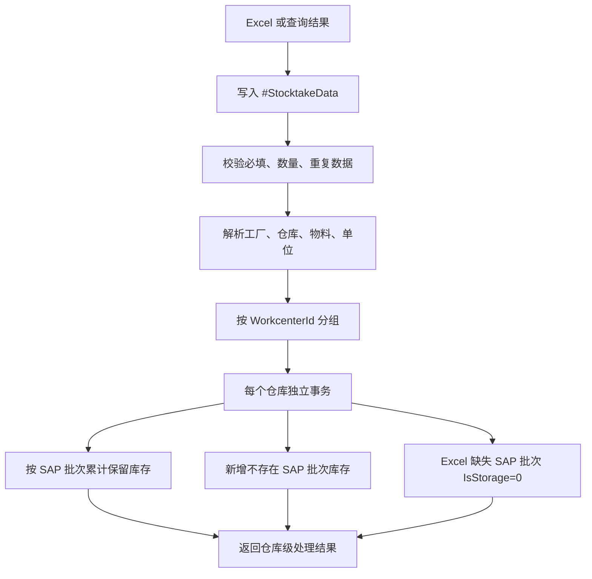

# Design: 库存盘点更新

## 状态
- **状态**：草稿 Draft
- **创建日期**：2026-06-18
- **数据库**：SQL Server
- **参考过程**：`MES/procedure/Batch_StocktakeUpdateRMInventory.sql`

---

## 1. 技术方案

### 1.1 总体方案
本功能建议使用 SQL Server 存储过程实现。外部程序先将 Excel 或查询结果写入临时表 `#StocktakeData`，再调用批量盘点更新存储过程，由存储过程完成校验、匹配、更新、新增和差异置出库。

推荐存储过程名称：

```sql
dbo.Batch_StocktakeUpdateRMInventory
```

推荐调用方式：

```sql
DECLARE @ReturnMessage NVARCHAR(MAX);

EXEC dbo.Batch_StocktakeUpdateRMInventory
    @I_ReturnMessage = @ReturnMessage OUTPUT,
    @CreateUserId = '操作人ID',
    @DryRun = 1; -- 1=预览校验，0=正式更新

SELECT @ReturnMessage AS ReturnMessage;
```

### 1.2 设计原则
- 以仓库 `WorkcenterId` 为最小事务单位。
- 每段核心 SQL 逻辑必须添加中文注释。
- 所有更新必须限定仓库范围，避免误改其他仓库库存。
- 预览模式不修改正式表，只返回校验和预计影响数量。
- 正式更新前建议先执行预览模式。

---

## 2. 数据结构设计

### 2.1 输入临时表
调用存储过程前，需要创建并写入 `#StocktakeData`。

```sql
CREATE TABLE #StocktakeData
(
    RowNo INT NOT NULL,                    -- Excel 行号，便于返回错误位置
    FactoryName NVARCHAR(100) NOT NULL,    -- 工厂
    WarehouseName NVARCHAR(100) NOT NULL,  -- 仓库
    ProductNo NVARCHAR(100) NOT NULL,      -- 物料号
    StockQty DECIMAL(18, 8) NOT NULL,      -- 库存数量
    UOMName NVARCHAR(50) NOT NULL,         -- 单位
    SAPBatchNo NVARCHAR(100) NOT NULL,     -- SAP批号，用于匹配 ProductionLotNO
    LotSN NVARCHAR(100) NULL               -- MES批号，盘点来源通常不提供，不参与主匹配
);
```

### 2.2 目标库存表字段
`WW_RMInventory` 的核心字段如下：

| 字段 | 用途 | 来源 |
|---|---|---|
| `WWId` | 库存主键 | 系统生成 |
| `FactoryId` | 工厂 ID | 工厂主数据解析 |
| `WorkcenterId` | 仓库 ID | 仓库主数据解析 |
| `ProductId` | 物料 ID | 物料主数据解析 |
| `Qty` | 当前库存数量 | 盘点数量或累计保留后的剩余数量 |
| `OrgQty` | 原始库存数量 | 新增时使用盘点数量，更新时不修改 |
| `UOMId` | 单位 ID | 单位主数据解析 |
| `LotSN` | MES 内部批号 | 原库存保留；新增时通过 `WW_MP_LotSN` 规则生成 |
| `ProductionLotNO` | SAP 批号 | Excel SAP批号 |
| `IsStorage` | 是否在库 | 盘点规则 |
| `ModifyDate` | 修改时间 | `GETDATE()` |
| `CreateDate` | 创建时间 | `GETDATE()` |

### 2.3 主数据映射
已复核 `MES/table/` 下真实表结构，并结合现有存储过程用法确认字段映射：

| 业务字段 | 目标 ID | 已知/候选表 | 已知/候选字段 | 备注 |
|---|---|---|---|---|
| 工厂 | `FactoryId` | `Factory` | `FactoryName` | `FactoryName` 有唯一约束 |
| 仓库 | `WorkcenterId` | `Workcenter` | `WorkcenterName` | 同时限定 `Workcenter.FactoryId = Factory.FactoryId` |
| 物料号 | `ProductId` | `Product` + `ProductRoot` | `ProductRoot.ProductName` | `Product.ProductRootId = ProductRoot.ProductRootId` |
| 单位 | `UOMId` | `UOM` | `UOMName` 或 `ERPUnitcode` | 优先支持名称，也兼容 ERP 单位编码 |

> 注意：物料号不直接匹配 `Product` 表字段，而是匹配 `ProductRoot.ProductName` 后取得对应 `Product.ProductId`。

---

## 3. 数据流



---

## 4. 存储过程流程设计

### 4.1 参数设计

```sql
CREATE PROCEDURE dbo.Batch_StocktakeUpdateRMInventory
    @I_ReturnMessage NVARCHAR(MAX) = '' OUTPUT, -- 返回 JSON 结果
    @CreateUserId CHAR(12) = '',                -- 操作人
    @DryRun BIT = 0                             -- 1=预览，0=正式更新
AS
BEGIN
    SET NOCOUNT ON;
END
```

### 4.2 全局校验
执行更新前先做全局校验：

- 检查 `#StocktakeData` 是否存在。
- 检查盘点数据是否为空。
- 检查必填字段是否为空。
- 检查库存数量是否为负数。
- 检查同一 `FactoryName + WarehouseName + ProductNo + SAPBatchNo` 是否重复。

建议重复数据校验 SQL：

```sql
-- 校验同一工厂、仓库、物料、SAP批号是否重复，避免同一盘点口径被多次覆盖
IF EXISTS (
    SELECT 1
    FROM #StocktakeData
    GROUP BY FactoryName, WarehouseName, ProductNo, SAPBatchNo
    HAVING COUNT(1) > 1
)
BEGIN
    SET @I_ReturnMessage = N'盘点数据存在重复的工厂、仓库、物料号、SAP批号，请先清理后再导入';
    RETURN -1;
END
```

### 4.3 主数据解析
将 Excel 文本解析为系统 ID：

```sql
-- 将 Excel 中的工厂、仓库、物料、单位解析为 MES 主数据 ID
SELECT
    s.RowNo,
    s.FactoryName,
    s.WarehouseName,
    s.ProductNo,
    s.StockQty,
    s.UOMName,
    s.SAPBatchNo,
    s.LotSN,
    f.FactoryId,
    wc.WorkcenterId,
    p.ProductId,
    u.UOMId
INTO #ResolvedStocktakeData
FROM #StocktakeData s
LEFT JOIN dbo.Factory f WITH (NOLOCK)
    ON f.FactoryName = LTRIM(RTRIM(s.FactoryName))
LEFT JOIN dbo.Workcenter wc WITH (NOLOCK)
    ON wc.WorkcenterName = LTRIM(RTRIM(s.WarehouseName))
   AND wc.FactoryId = f.FactoryId
LEFT JOIN dbo.ProductRoot pr WITH (NOLOCK)
    ON pr.ProductName = LTRIM(RTRIM(s.ProductNo))
LEFT JOIN dbo.Product p WITH (NOLOCK)
    ON p.ProductRootId = pr.ProductRootId
LEFT JOIN dbo.UOM u WITH (NOLOCK)
    ON u.UOMName = LTRIM(RTRIM(s.UOMName))
    OR u.ERPUnitcode = LTRIM(RTRIM(s.UOMName));
```

以上 SQL 已按当前表结构修正为真实字段，后续存储过程开发应沿用该映射。

### 4.4 按仓库独立事务处理
解析完成后，按 `WorkcenterId` 分组处理。每个仓库单独开启事务：

```sql
-- 每个仓库独立事务处理，某仓失败只回滚该仓，不影响其他仓库
BEGIN TRY
    BEGIN TRANSACTION;

    -- 1. 按 SAP 批次累计保留已存在库存
    -- 2. 新增不存在 SAP 批次库存
    -- 3. 将 Excel 缺失 SAP 批次置为不在库
    -- 4. 写入该仓处理日志

    COMMIT TRANSACTION;
END TRY
BEGIN CATCH
    IF @@TRANCOUNT > 0
        ROLLBACK TRANSACTION;

    -- 记录该仓失败原因，继续处理下一个仓库
END CATCH
```

### 4.5 更新已存在库存
匹配条件：

```sql
FactoryId + WorkcenterId + ProductId + ProductionLotNO
```

一行盘点结果可能匹配 `WW_RMInventory` 多行库存。设计上先生成匹配 CTE，按创建时间从新到旧计算累计数量，再决定每一行库存是完整保留、部分保留，还是置为不在库。

```sql
-- 按工厂、仓库、物料、SAP批次匹配库存；同一盘点行可能命中多行 MES 批次
WITH MatchedInventory AS
(
    SELECT
        inv.WWId,
        inv.Qty,
        s.StockQty,
        s.UOMId,
        SUM(inv.Qty) OVER (
            PARTITION BY inv.FactoryId, inv.WorkcenterId, inv.ProductId, inv.ProductionLotNO
            ORDER BY inv.CreateDate DESC, inv.WWId DESC
            ROWS BETWEEN UNBOUNDED PRECEDING AND CURRENT ROW
        ) AS RunningQty
    FROM dbo.WW_RMInventory inv
    INNER JOIN #ResolvedStocktakeData s
        ON s.FactoryId = inv.FactoryId
       AND s.WorkcenterId = inv.WorkcenterId
       AND s.ProductId = inv.ProductId
       AND s.SAPBatchNo = inv.ProductionLotNO
    WHERE s.WorkcenterId = @CurrentWorkcenterId
      AND inv.IsStorage = 1
)
-- 根据累计数量保留最新库存批次，最后一个批次可按剩余数量调整
UPDATE inv
SET
    inv.Qty = CASE
        WHEN m.RunningQty <= m.StockQty THEN inv.Qty
        WHEN m.RunningQty - m.Qty < m.StockQty AND m.RunningQty > m.StockQty
            THEN m.StockQty - (m.RunningQty - m.Qty)
        ELSE inv.Qty
    END,
    inv.UOMId = m.UOMId,
    inv.IsStorage = CASE
        WHEN m.RunningQty - m.Qty < m.StockQty THEN 1
        ELSE 0
    END,
    inv.ModifyDate = GETDATE()
FROM dbo.WW_RMInventory inv
INNER JOIN MatchedInventory m
    ON m.WWId = inv.WWId;
```

处理口径：

- `RunningQty <= StockQty`：该批次完整保留，数量不变。
- `RunningQty - Qty < StockQty AND RunningQty > StockQty`：该批次作为最后保留批次，数量改为剩余需要数量。
- `RunningQty - Qty >= StockQty`：该批次超出盘点数量，标记 `IsStorage=0`。

### 4.6 新增不存在库存
新增条件：

```sql
NOT EXISTS (
    SELECT 1
    FROM dbo.WW_RMInventory inv
    WHERE inv.FactoryId = s.FactoryId
      AND inv.WorkcenterId = s.WorkcenterId
      AND inv.ProductId = s.ProductId
      AND inv.ProductionLotNO = s.SAPBatchNo
      AND inv.IsStorage = 1
)
```

新增字段建议：

新增前需要先为每条待新增盘点数据生成主键和内部批号：

```sql
-- 为新增库存记录生成 WWId 和 MES 内部批号，避免新增库存缺少可追踪批号
EXEC dbo.SysGetObjectPKId '', 'WW_RMInventory', @NewWWId OUTPUT;

EXEC dbo.StartRuleSNDoMethod
    @I_ReturnMessage = @I_ReturnMessage OUTPUT,
    @SNRuleId = @SNRuleId,
    @RCharStr = N'',
    @JumpQty = 1,
    @NewSN = @NewLotSN OUTPUT;
```

其中 `@SNRuleId` 来自：

```sql
-- 获取库存内部批号生成规则，沿用现有领料拆批逻辑中的 WW_MP_LotSN 规则
SELECT @SNRuleId = SNRuleId
FROM dbo.SNRule WITH (NOLOCK)
WHERE SNRuleName = 'WW_MP_LotSN'
  AND IsActivity = 1;
```

```sql
-- 新增盘点中存在但库存表中不存在的 SAP 批次，补齐 MES 库存
INSERT INTO dbo.WW_RMInventory
(
    WWId,
    LotSN,
    LotStatus,
    Qty,
    OrgQty,
    ProductId,
    UOMId,
    ProductionDate,
    ProductionLotNO,
    ReceiveDate,
    ValidityEndDate,
    FactoryId,
    WorkcenterId,
    IsStorage,
    IsInternalLot,
    ModifyDate,
    CreateDate
)
SELECT
    s.NewWWId,
    s.NewLotSN, -- 新增库存不使用盘点来源 LotSN，使用系统规则生成 MES 内部批号
    '1',
    s.StockQty,
    s.StockQty,
    s.ProductId,
    s.UOMId,
    CONVERT(VARCHAR(50), GETDATE(), 120),
    ISNULL(s.SAPBatchNo, ''),
    GETDATE(),
    CAST('9999-12-31' AS DATE),
    s.FactoryId,
    s.WorkcenterId,
    1,
    0,
    GETDATE(),
    GETDATE()
FROM #ResolvedStocktakeData s
WHERE s.WorkcenterId = @CurrentWorkcenterId
  AND NOT EXISTS (
      SELECT 1
      FROM dbo.WW_RMInventory inv
      WHERE inv.FactoryId = s.FactoryId
        AND inv.WorkcenterId = s.WorkcenterId
        AND inv.ProductId = s.ProductId
        AND inv.ProductionLotNO = s.SAPBatchNo
        AND inv.IsStorage = 1
  );
```

`NewWWId` 需要通过系统现有主键生成逻辑提前生成，例如参考现有过程中的 `SysGetObjectPKId`。`NewLotSN` 通过 `StartRuleSNDoMethod` 按 `WW_MP_LotSN` 规则逐行生成。

### 4.7 Excel 缺失物料或 SAP 批次置为不在库
按业务确认口径，处理本次盘点仓库内全部在库库存；如果库存表中该仓库存在某物料，但 Excel 中该仓库不存在该物料，也需要置为不在库：

```sql
-- 将本仓库中 Excel 没有出现的物料或 SAP 批次标记为不在库
UPDATE inv
SET
    inv.IsStorage = 0,
    inv.ModifyDate = GETDATE()
FROM dbo.WW_RMInventory inv
WHERE inv.WorkcenterId = @CurrentWorkcenterId
  AND inv.IsStorage = 1
  AND NOT EXISTS (
      SELECT 1
      FROM #ResolvedStocktakeData s
      WHERE s.FactoryId = inv.FactoryId
        AND s.WorkcenterId = inv.WorkcenterId
        AND s.ProductId = inv.ProductId
        AND s.SAPBatchNo = inv.ProductionLotNO
  );
```

---

## 5. 日志与返回值设计

### 5.1 处理批次号
每次执行生成一个批次号：

```sql
SET @BatchNo = 'ST' + FORMAT(GETDATE(), 'yyyyMMddHHmmss');
```

### 5.2 仓库级结果
建议返回以下字段：

| 字段 | 说明 |
|---|---|
| `batchNo` | 本次盘点批次号 |
| `totalWarehouses` | 总仓库数 |
| `successWarehouses` | 成功仓库数 |
| `failedWarehouses` | 失败仓库数 |
| `details` | 每个仓库处理明细 |

`details` 明细字段：

| 字段 | 说明 |
|---|---|
| `factoryName` | 工厂 |
| `workcenterId` | 仓库 ID |
| `workcenterName` | 仓库名称 |
| `status` | `success` 或 `failed` |
| `errorMsg` | 失败原因 |
| `totalRows` | 该仓盘点行数 |
| `updatedRows` | 更新或累计保留行数 |
| `insertedRows` | 新增行数 |
| `removedRows` | 置出库行数，包含缺失 SAP 批次和超出盘点数量的更旧批次 |

### 5.3 返回 JSON 示例

```json
{
  "result": true,
  "message": "盘点更新完成",
  "batchNo": "ST20260618113000",
  "totalWarehouses": 2,
  "successWarehouses": 2,
  "failedWarehouses": 0,
  "details": [
    {
      "factoryName": "一厂",
      "workcenterId": "WH0000000001",
      "workcenterName": "原材料仓",
      "status": "success",
      "errorMsg": "",
      "totalRows": 100,
      "updatedRows": 80,
      "insertedRows": 10,
      "removedRows": 5
    }
  ]
}
```

---

## 6. 性能设计

### 6.1 推荐集合处理
盘点数据可能较多，建议优先使用集合更新和集合新增：

- 用 `UPDATE ... FROM ... JOIN` 批量更新。
- 用 `INSERT ... SELECT` 批量新增。
- 用窗口函数 `SUM(...) OVER (...)` 处理同一 SAP 批次多库存行累计保留。
- 用 `NOT EXISTS` 处理缺失 SAP 批次置出库。

### 6.2 索引建议
如果数据量较大，建议 DBA 评估以下索引：

```sql
-- 用于盘点更新匹配库存记录
CREATE INDEX IX_WW_RMInventory_Stocktake
ON dbo.WW_RMInventory (FactoryId, WorkcenterId, ProductId, ProductionLotNO, IsStorage, CreateDate);
```

上线前需要确认是否已有类似索引，避免重复创建。

---

## 7. 风险与控制

| 风险 | 影响 | 控制方式 |
|---|---|---|
| 主数据字段名不一致 | 存储过程无法编译或匹配失败 | 实施前复核 `Factory`、`Product`、`Workcenter`、`UOM` 字段 |
| Excel 缺失物料或 SAP 批次置出库范围过大 | 误将未纳入 Excel 的本仓物料置为不在库 | 正式更新前必须先执行 `DryRun=1` 并由业务确认该仓盘点 Excel 已覆盖全仓物料 |
| 重复盘点行 | 同一库存被多次覆盖 | 执行前阻断重复数据 |
| 同一 SAP 批次多行库存 | 数量可能只更新一行或误清旧批次 | 使用窗口函数按创建时间从新到旧累计保留 |
| 数量异常 | 库存数量错误 | 阻断负数和空数量 |
| 某仓数据异常 | 影响其他仓库 | 每仓独立事务 |
| 正式更新不可逆 | 数据恢复困难 | 正式执行前先 DryRun，并建议备份受影响库存 |

---

## 8. 测试设计

### 8.1 正常场景
- 已存在 SAP 批次且只命中一行库存：`Qty` 与 `IsStorage` 按盘点数量更新。
- 已存在 SAP 批次且命中多行库存：按 `CreateDate DESC, WWId DESC` 累计保留，最后一个保留批次可调整为剩余数量。
- 不存在 SAP 批次：新增库存记录，`ProductionLotNO` 写入 SAP 批次，`IsStorage=1`。
- Excel 缺失 SAP 批次：库存表对应 SAP 批次 `IsStorage=0`。

### 8.2 异常场景
- 工厂不存在。
- 仓库不存在。
- 物料号不存在。
- 单位不存在。
- 库存数量为空或为负数。
- 同一工厂、仓库、物料、SAP批号重复。

### 8.3 事务场景
- 仓库 A 数据正常，仓库 B 数据异常。
- 预期仓库 A 成功提交，仓库 B 回滚并返回失败原因。

### 8.4 预览场景
- `DryRun=1` 时不修改 `WW_RMInventory`。
- 返回预计更新、新增、置出库数量，并能体现多库存行累计保留后的影响行数。
