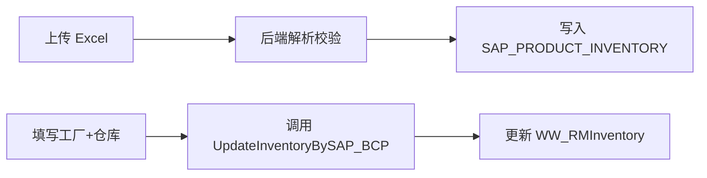

# Design: 半成品盘点导入

## 状态
- **状态**：草稿 Draft
- **创建日期**：2026-06-26
- **复用基座**：`web/stocktake-import`（MES 工具箱，React + ASP.NET Core）
- **数据库**：SQL Server `OrBitMOMTestBack`

---

## 1. 总体方案
在现有 MES 工具箱中新增「半成品盘点」模块，仿照「库存盘点导入」实现：

1. 上传 Excel → 解析 → 写入 `SAP_PRODUCT_INVENTORY`。
2. 填写工厂 + 仓库 → 调用 `dbo.UpdateInventoryBySAP_BCP`。

不新增/不修改存储过程，仅新增前后端的导入与触发能力。



---

## 2. 后端设计（参照 `StocktakeController` / `StocktakeDbService`）

### 2.1 新增接口

| 方法 | 路径 | 说明 |
|---|---|---|
| GET | `/api/sap-inventory/template` | 下载半成品 Excel 模板 |
| POST | `/api/sap-inventory/import` | 上传 Excel 写入 `SAP_PRODUCT_INVENTORY` |
| POST | `/api/sap-inventory/execute` | 按工厂+仓库调用 `UpdateInventoryBySAP_BCP` |

### 2.2 导入逻辑（`ImportSapInventoryAsync`）
参照 `StocktakeDbService.ImportStocktakeDataAsync`：

- 解析 Excel 行（列见 requirements 第 3 节）。
- 在事务内：先提取本批数据去重后的「工厂 + 仓库」集合，再按集合删除旧数据，最后参数化批量 `INSERT`。
- 每行 `Id = NEWID()`（或后端生成 GUID 字符串），`isChange = 0`。
- 导入前执行字段长度校验（按表结构限制），超长行直接返回错误，不落库。

```sql
-- 【清空】按本次导入的工厂+仓库删除旧数据
DELETE FROM dbo.SAP_PRODUCT_INVENTORY
WHERE FactoryName = @FactoryName AND WorkcenterName = @WorkcenterName;

-- 【写入】参数化插入半成品库存数据
INSERT INTO dbo.SAP_PRODUCT_INVENTORY
(Id, FactoryName, WorkcenterName, ProductName, LotSN,
 ProductInventoryNum, CheckNum, LockQty, UomName, StorageDate, Note, isChange)
VALUES
(@Id, @FactoryName, @WorkcenterName, @ProductName, @LotSN,
 @ProductInventoryNum, @CheckNum, @LockQty, @UomName, @StorageDate, @Note, '0');
```

### 2.3 执行逻辑（`ExecuteSapInventoryAsync`）
参照 `StocktakeDbService.ExecuteStocktakeUpdateAsync`，但存储过程无输出参数：

```csharp
var parameters = new DynamicParameters();
parameters.Add("@WarehouseName", warehouseName);
parameters.Add("@FactoryName", factoryName);
parameters.Add("@ReturnValue", dbType: DbType.Int32, direction: ParameterDirection.ReturnValue);

await connection.ExecuteAsync(new CommandDefinition(
    "dbo.UpdateInventoryBySAP_BCP",
    parameters,
    commandType: CommandType.StoredProcedure,
    cancellationToken: cancellationToken));
```

- 调用存储过程前先校验工厂仓库是否存在（`Factory.FactoryName + Workcenter.WorkcenterName`），不存在直接返回业务失败，不进入存储过程。
- 存储过程内部 `RETURN 0` 时，以“执行完成（可能无可处理数据）”提示；异常走 `RAISERROR`。
- 异常由存储过程 `RAISERROR` 抛出，后端 try/catch 透传可读信息。

建议增加预检 SQL：

```sql
SELECT TOP 1 1
FROM dbo.Workcenter wc
INNER JOIN dbo.Factory f ON f.FactoryId = wc.FactoryId
WHERE f.FactoryName = @FactoryName
  AND wc.WorkcenterName = @WarehouseName;
```

### 2.4 字段映射
目标表字段以 `MES/table/SAP_PRODUCT_INVENTORY.sql` 为准：`Id`(PK)、`FactoryName`、`WorkcenterName`、`ProductName`、`LotSN`、`ProductInventoryNum`、`CheckNum`、`LockQty`、`UomName`、`StorageDate`、`Note`、`isChange`。

字段长度约束（导入校验必做）：
- `FactoryName nvarchar(10)`
- `ProductName nvarchar(18)`
- `WorkcenterName nvarchar(4)`
- `LotSN nvarchar(10)`
- `UomName nvarchar(3)`
- `StorageDate nvarchar(30)`
- `Note nvarchar(30)`

---

## 3. 前端设计（参照 `frontend/src/modules/stocktake`）

### 3.1 新增模块
- `config/modules.ts` 增加卡片：`{ id:'sap-inventory', title:'半成品盘点', path:'/sap-inventory', icon:'inventory', enabled:true }`。
- `modules/sap-inventory/`：`index.tsx`、`api.ts`、`types.ts`。
- `App.tsx` 注册路由 `/sap-inventory`。

### 3.2 页面交互
1. 顶部：下载模板按钮 + 选择 Excel + 「导入」按钮 → 调 `/import`，显示导入行数/错误。
2. 下方：工厂、仓库输入框 + 「执行盘点」按钮 → 调 `/execute`，显示结果提示。
3. 所有接口响应统一按 `ApiResponse<T>` 解析并展示 `message`，与现有模块保持一致。

---

## 4. 与现有「库存盘点导入」的关系

| 维度 | 库存盘点导入（原材料） | 半成品盘点（本设计） |
|---|---|---|
| 暂存表 | `TempStocktakeData` | `SAP_PRODUCT_INVENTORY` |
| 存储过程 | `Batch_StocktakeUpdateRMInventory` | `UpdateInventoryBySAP_BCP` |
| 触发参数 | `@DryRun` | `@FactoryName` + `@WarehouseName` |
| 预览 | 有 DryRun | 无（直接执行） |
| 返回 | JSON | 返回值 / 提示文本 |

两个模块共用同一前端门户与数据库连接配置，互不影响。

---

## 5. 风险与控制

| 风险 | 控制 |
|---|---|
| 导入清空范围过大 | 按「工厂+仓库」删除，不全表清空；导入前确认范围 |
| 无预览直接执行 | 执行前先确认 `SAP_PRODUCT_INVENTORY` 数据正确，必要时备份 `WW_RMInventory` |
| 工厂/仓库填写与 Excel 不一致 | 执行表单与 Excel 工厂仓库需一致，否则 `RETURN 0` 无数据 |
| `Id` 主键冲突 | 使用 GUID 生成，避免重复 |
| 按行删插导致数据被覆盖 | 必须先按去重工厂仓库集合删除，再统一插入 |
| 文本超长导致 SQL 写入失败 | 后端先按字段长度校验并返回行级错误 |

---

## 6. 测试要点
- 下载模板列正确。
- 导入正常：行数写入 `SAP_PRODUCT_INVENTORY`，`isChange=0`。
- 导入缺列 / 空必填：返回错误提示。
- 重复导入同工厂仓库：旧数据被覆盖。
- 执行正常：`UpdateInventoryBySAP_BCP` 更新 `WW_RMInventory`，数据 `isChange=1`。
- 执行找不到仓库 / 无数据：提示正确。
